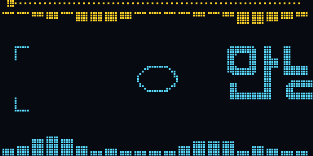

# 가사 큐브 (Lyrics Cube)

노래에 맞춰 가사가 한 단어씩 나오는 작은 OLED 화면이에요. 투명 프리즘 큐브를 올리면 글자가 공중에 떠 있는 것처럼 보여요.



## 이런 걸 해요

- 가사가 **한 단어씩** 나와요. 단어마다 등장 방식이 바뀌어요(밀려 들어오기, 떨어지기, 타자, 지지직).
- 단어가 바뀔 때 원이 퍼지고, 꺾쇠가 숨 쉬고, 아래 막대가 튀어요. 막대는 소리를 듣는 게 아니라 단어에 맞춰 움직이는 애니메이션이에요.
- 강조하고 싶은 단어는 화면이 번쩍 반전돼요.
- **BOOT 버튼**: 누를 때마다 큐브용(좌우 뒤집힘) ↔ 정면용이 바뀌어요. 꺼져도 기억해요.
- 맥북에서 명령 하나로 **노래 재생 + 시작 신호**를 보내요. USB가 꽂혀 있으면 USB로, 아니면 와이파이로 보내요.
- 노래 파일만 있으면 **가사 시간을 자동으로 계산**해요(Whisper + 목소리 분리).

## 필요한 것

| 부품 | 설명 | 구매 링크 |
|---|---|---|
| ESP32 + 0.96인치 OLED 일체형 보드 | ideaspark ESP32 0.96" OLED (SSD1306, 128×64). 화면 위 16줄이 노란색인 모델 기준으로 디자인했어요 | [알리익스프레스](https://s.click.aliexpress.com/e/_c3EHWbH1) |
| 광학 빔스플리터 큐브 | 화면 위에 올리는 투명 프리즘 큐브 | [알리익스프레스](https://s.click.aliexpress.com/e/_c3tRfNZZ) |
| USB 케이블 | 보드가 마이크로 5핀이에요 | |
| 맥 (Apple Silicon) | 가사 시간 계산과 노래 재생용. 다른 컴퓨터에서는 시험하지 않았어요 | |

> 위 구매 링크는 제휴 링크예요. 이 링크로 구매하면 방구석 테크랩이 소정의 수수료를 받을 수 있어요. 구매 가격은 똑같아요.

## 굽는 방법 (맥 기준)

1. Arduino CLI와 ESP32 보드 패키지, U8g2 라이브러리를 설치해요.
   ```bash
   arduino-cli core install esp32:esp32
   arduino-cli lib install U8g2
   ```
2. 와이파이 정보를 넣어요. `secrets.example.h`를 `secrets.h`로 복사하고 내 와이파이 이름과 비밀번호로 바꿔요.
3. 가사·글꼴 데이터를 만들어요. `lyrics.txt`가 없으면 시험용 `lyrics.demo.txt`를 써요.
   ```bash
   python3 tools/make_data.py
   ```
   맥에 있는 배민 도현체를 자동으로 찾아요. 다른 글꼴을 쓰려면 `LYRICS_FONT=/경로/글꼴.ttf python3 tools/make_data.py`.
4. 보드에 올려요. 포트 이름은 `ls /dev/cu.usbserial*`로 확인하세요. 이 보드는 속도를 115200으로 낮춰야 올라갔어요.
   ```bash
   arduino-cli compile -b esp32:esp32:esp32:UploadSpeed=115200 .
   arduino-cli upload -b esp32:esp32:esp32:UploadSpeed=115200 -p /dev/cu.usbserial-XXX .
   ```

## 내 노래로 바꾸기

1. 노래를 `song/song.mp3`, 가사를 `원본가사.txt`(한 줄씩)로 저장해요.
2. 도구를 설치해요.
   ```bash
   python3 -m venv tools/.venv
   tools/.venv/bin/pip install mlx-whisper demucs pyserial numpy pillow
   ```
3. 순서대로 실행해요.
   ```bash
   tools/.venv/bin/python tools/transcribe.py   # 노래 듣고 단어 시간 뽑기
   tools/.venv/bin/python tools/vocals.py       # 목소리만 분리 (쉬는 구간 맞추기용)
   tools/.venv/bin/python tools/align.py        # 원본 가사와 맞춰 lyrics.txt 만들기
   python3 tools/make_data.py                   # 보드용 데이터 만들기
   ```
4. `lyrics.txt`는 직접 고칠 수 있어요. 한 줄에 `시작초 단어`이고, 끝에 `*`를 붙이면 그 단어에서 화면이 번쩍여요. `(추정)` 표시는 Whisper가 못 들어서 앞뒤 시간으로 짐작한 거예요.
5. 다시 보드에 올려요.

Whisper는 쉬는 구간을 다음 단어에 붙여서 가사가 일찍 나오는 경우가 있어요. 그래서 목소리가 실제로 다시 나오는 순간으로 시작 시간을 늦추는 단계(`vocals.py`)를 넣었어요.

## 재생하기

```bash
tools/.venv/bin/python play.py          # 노래 + 시작 신호
tools/.venv/bin/python play.py 0.2      # 가사가 빠르면 +, 느리면 - 로 조절
tools/.venv/bin/python play.py --wifi   # USB가 꽂혀 있어도 와이파이로
```

- 보드는 켜지면 ♪ 화면으로 기다려요. 와이파이에 연결되면 화면 위 구석에 작은 점이 생겨요.
- 멈추려면 Ctrl+C.
- 와이파이로는 `lyrics-cube.local` 이름으로 보드를 찾아요.

## 맥북에서 미리보기

보드와 **같은 그리기 코드**(`scene.h`)를 맥에서 돌려서 GIF나 노래가 들어간 mp4를 만들 수 있어요.

```bash
U=~/Documents/Arduino/libraries/U8g2/src/clib
clang -O2 -I$U tools/preview.c $U/u8g2_*.c $U/u8x8_*.c -o /tmp/preview -lm
/tmp/preview 33 > /tmp/frames.raw
tools/.venv/bin/python tools/make_video.py /tmp/frames.raw 33 mockups/preview_song.mp4
```

## 파일 안내

| 파일 | 하는 일 |
|---|---|
| `lyrics_cube.ino` | 보드 프로그램 (버튼, USB·와이파이 신호) |
| `scene.h` | 화면 그리기 (보드·미리보기 공용) |
| `play.py` | 맥에서 노래 재생 + 시작 신호 |
| `lyrics.demo.txt` | 시험용 가사 |
| `tools/` | 가사 시간 계산, 글꼴 변환, 미리보기 |
| `mockups/` | 디자인 시안 그림 |

## 알아 둘 점

- 노래 파일과 가사는 저작권 때문에 저장소에 없어요. 각자 준비하세요.
- 보조배터리 중에는 전기를 적게 쓰는 기기를 꽂으면 저절로 꺼지는 것도 있어요.
- 이 보드는 스피커와 마이크가 없어요. 노래는 맥에서 나와요.

## 라이선스

MIT. 함께 쓰는 라이브러리·글꼴은 [THIRD_PARTY.md](THIRD_PARTY.md)를 보세요.

---

## English summary

A tiny ESP32 + 0.96" OLED lyric display. Lyrics appear word by word in sync with a song; put a beam-splitter prism cube on top to make them float. Word timings are generated automatically from the song with Whisper, refined with Demucs vocal separation. A Mac script plays the song and sends a start signal over USB serial or Wi-Fi (`lyrics-cube.local`). The BOOT button toggles mirrored (cube) / normal view. The same drawing code (`scene.h`) runs on the board and in a Mac preview tool. Songs, lyrics and font-derived glyph data are not included; a demo lyric file is. MIT licensed. Parts links in the table above are affiliate links (the price is the same for you).
